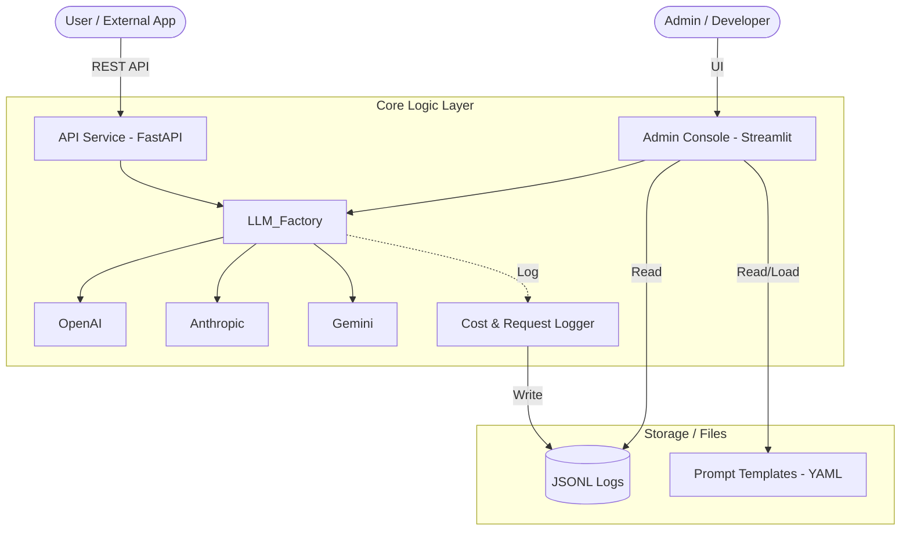

# Project Architecture

## 1. Overview
This project is a universal LLM project module designed to integrate various LLM (Large Language Model) providers into a consistent interface, providing monitoring and testing capabilities. It is architected with **reusability** and **scalability** as top priorities.

## 2. System Architecture

The project consists of three main layers:
1. **API Layer (FastAPI)**: Provides standardized RESTful APIs for external services to utilize LLM functionalities.
2. **Admin Layer (Streamlit)**: Provides a UI for operators and developers to observe system status and test prompts.
3. **Core Logic Layer (Python Modules)**: Handles the actual business logic, including the LLM Factory, cost tracking, and prompt management.



## 3. Directory Structure

```text
LLM_Projcet_Module/
├── api/                # API Service Layer (FastAPI)
│   └── main.py         # API entry point and endpoint definitions
├── streamlit/          # Admin Console Layer (Streamlit)
│   └── admin.py        # Dashboard and Playground UI
├── src/                # Core Logic and Modules
│   ├── core/           # Configuration management (Settings, API Keys)
│   ├── llm/            # LLM Factory (OpenAI, Anthropic, Gemini integration)
│   ├── prompts/        # Prompt template management
│   │   ├── templates/  # YAML File Repository (system.yaml, etc.)
│   │   └── prompt_manager.py  # Template Loader & Utilities
│   ├── utils/          # Utilities
│   │   ├── logger.py       # Singleton Logger
│   │   ├── callbacks.py    # Cost Tracking Callbacks
│   │   └── decorators.py   # Utility Decorators
│   └── (modules)       # agents, retrieval, vectorstore (Scalable modules)
├── tests/              # Test Strategy Implementation (Pytest)
│   ├── unit/           # Sociable Unit Tests (Core Logic)
│   ├── integration/    # Broad Integration & Contract Tests (API)
│   └── conftest.py     # Common Fixtures & Mocks
├── logs/               # System logs (cost.jsonl, api_requests.jsonl)
├── docs/               # Project documentation (KR/EN)
├── Dockerfile          # Container build configuration
└── README.md           # Project guide
```

## 4. Key Components

1. **LLM Factory (`src/llm/`)**: Abstracted interface for multiple LLM providers, enabling consistent API calls with built-in support for Structured Output.
2. **Prompt Management (`src/prompts/`)**: Manages prompts based on YAML files, loading them at runtime and substituting variables via `PromptManager`.
3. **Cost Tracking (`src/utils/`)**: A callback-based system that calculates and logs token usage and costs for every LLM call in real-time.
4. **Admin Dashboard (`streamlit/`)**: Analyzes data from the `logs/` directory to visualize latency, success rates, and costs.
5. **API Middleware (`api/`)**: Automatically records performance metrics for every HTTP request to ensure high observability.
