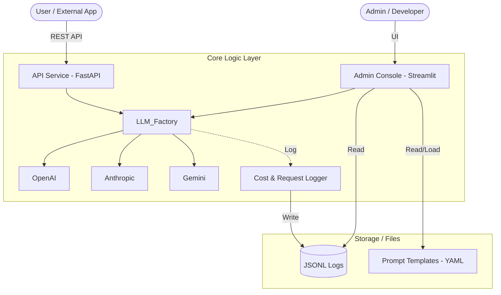

# 프로젝트 아키텍처 (Project Architecture)

## 1. 개요 (Overview)
본 프로젝트는 다양한 LLM(Large Language Model) 프로바이더를 통합하여 일관된 인터페이스로 제공하고, 이를 모니터링 및 테스트할 수 있는 범용 LLM 프로젝트 모듈입니다. **재사용성**과 **확장성**을 최우선으로 설계되었습니다.

## 2. 시스템 아키텍처 (System Architecture)

프로젝트는 크게 세 가지 계층으로 구성됩니다:
1. **API Layer (FastAPI)**: 외부 서비스가 LLM 기능을 이용할 수 있도록 표준화된 RESTful API를 제공합니다.
2. **Admin Layer (Streamlit)**: 운영자 및 개발자가 시스템 상태를 관측하고 프롬프트를 테스트할 수 있는 UI를 제공합니다.
3. **Core Logic Layer (Python Modules)**: LLM Factory, 비용 추적, 프롬프트 관리 등 실제 비즈니스 로직을 담당합니다.



## 3. 폴더 구조 (Directory Structure)

```text
LLM_Projcet_Module/
├── api/                # API 서비스 계층 (FastAPI)
│   └── main.py         # API 진입점 및 엔드포인트 정의
├── streamlit/          # 관리자 콘솔 계층 (Streamlit)
│   └── admin.py        # 대시보드 및 플레이그라운드 UI
├── src/                # 핵심 로직 및 모듈 (Core Logic)
│   ├── core/           # 설정 관리 (Settings, API Keys)
│   ├── llm/            # LLM Factory (OpenAI, Anthropic, Gemini 통합)
│   ├── prompts/        # 프롬프트 템플릿 관리
│   │   ├── templates/  # YAML 파일 저장소 (system.yaml 등)
│   │   └── prompt_manager.py  # 템플릿 로더 및 유틸리티
│   ├── utils/          # 유틸리티 (Utilities)
│   │   ├── logger.py       # 싱글톤 로거
│   │   ├── callbacks.py    # 비용 추적 콜백
│   │   └── decorators.py   # 유틸리티 데코레이터
│   └── (modules)       # agents, retrieval, vectorstore (확장용 모듈)
├── logs/               # 시스템 로그 (cost.jsonl, api_requests.jsonl)
├── docs/               # 프로젝트 문서 (KR/EN)
├── Dockerfile          # 컨테이너 빌드 설정
└── README.md           # 프로젝트 가이드
```

## 4. 핵심 컴포넌트 (Key Components)

1. **LLM Factory (`src/llm/`)**: 다양한 LLM 제공자의 API를 추상화하여 동일한 방식으로 호출할 수 있게 합니다. Structured Output을 기본으로 지원합니다.
2. **Prompt Management (`src/prompts/`)**: YAML 파일 기반으로 프롬프트를 관리하며, `PromptManager`를 통해 런타임에 로드하고 변수를 치환합니다.
3. **Cost Tracking (`src/utils/`)**: 콜백 시스템을 통해 모든 LLM 호출의 토큰 사용량과 비용을 실시간으로 계산하고 로깅합니다.
4. **Admin Dashboard (`streamlit/`)**: `logs/` 폴더의 데이터를 분석하여 지연 시간(Latency), 성공률, 비용을 시각화합니다.
5. **API Middleware (`api/`)**: 모든 HTTP 요청의 성능 지표를 자동으로 기록하여 관측성을 확보합니다.

